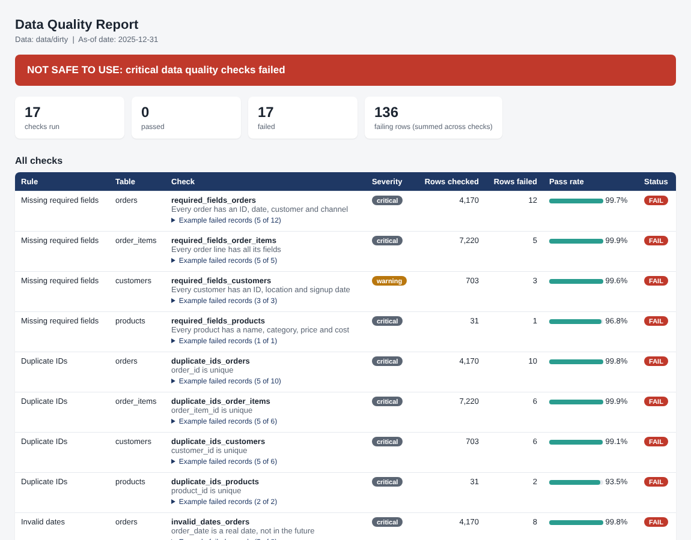

# Data Quality Checker

A configurable Python tool that checks a set of CSV tables for the problems that quietly break reports, and produces a one-page report saying whether the data is safe to use.

> **Demonstration project.** The data is synthetic (the same online-retail dataset used in my retail sales dashboard project).



## The problem

A company is about to build reports from data it has not verified: orders with no customer, repeated IDs, impossible dates, negative quantities, rows pointing at records that do not exist, and files that stopped arriving. Nobody finds out until a number looks wrong in front of a manager.

## What it checks

Seventeen checks across four related tables, in six families. All are defined in `config.json`, not in code.

| Family | What it catches | Checks |
|---|---|---|
| Missing required fields | Blank or "N/A" values in fields that must be filled | 4 |
| Duplicate IDs | An ID that appears more than once in a table | 4 |
| Invalid dates | Unreadable, impossible, too-old, or future dates | 2 |
| Unexpected values | Zero or negative quantity and price, discount outside 0 to 1, cost above price | 3 |
| Broken references | Orders for unknown customers, order lines for unknown orders or products | 3 |
| Freshness | Latest order older than the agreed limit (7 days) | 1 |

Each check is marked **critical** or **warning**. Any failed critical check makes the verdict "not safe to use".

## Outputs

| File | Contents |
|---|---|
| `dq_report.html` | One-page report: verdict, counts, pass rate per check, example failing records |
| `dq_results.csv` | One row per check: rows checked, rows failed, status |
| `failed_records.csv` | Every failing row (up to 500 per check) with the source row number and the reason |

The exit code is 0 for pass, 1 for a critical failure, and 2 if the check could not run, so it can run on a schedule and trigger an alert.

## Results

I planted known errors into a copy of the data and checked what the tool reported. `make_dirty_data.py` records the exact number planted for every check in `PLANTED_ERRORS.json`, and the tests compare the tool's output against it.

| Dataset | Checks failed | Failing rows |
|---|---:|---:|
| Flawed copy (planted errors, last two weeks of orders missing) | 17 of 17 | 136 |
| Clean dataset | 0 of 17 | 0 |

For every one of the 16 row-level checks, the number of failing rows equals the number planted, and the freshness check flags the missing December orders (latest order 17 days before the as-of date, limit 7). The clean dataset passes all 17 checks. The before/after report is `screenshots/3_before_after_clean_report.png`.

## Quick start

```
pip install -r requirements.txt
python make_dirty_data.py
python dq_check.py --data data/dirty --out reports/dirty --as-of 2025-12-31
python dq_check.py --data data/clean --out reports/clean --as-of 2025-12-31 --baseline reports/dirty/dq_results.csv
python -m pytest
```

`--as-of` fixes the reference date so the demo gives the same answer every time. Leave it out on real data and it uses today's date. `--baseline` adds a before/after table from an earlier run.

## Using it on your own data

Put each table in a folder as `<name>.csv`, list the tables in `config.json`, and add or edit checks. For example:

```json
{"id": "orphan_invoices_client", "family": "Broken references", "type": "foreign_key",
 "table": "invoices", "column": "client_id", "ref_table": "clients", "ref_column": "client_id",
 "severity": "critical", "description": "Every invoice belongs to a known client"}
```

Check types: `required_fields`, `duplicate_ids`, `valid_dates`, `positive_values`, `value_range`, `not_greater_than`, `foreign_key`, `freshness`.

## Design decisions

- **One problem, one check.** A row with a blank customer is reported by the required-fields rule only, not again as a broken reference. Otherwise one defect would inflate several counts.
- **Duplicates count every row in the group.** If an ID appears twice, both rows are reported, because a person has to decide which to keep.
- **Freshness ignores invalid and future dates,** so a mistyped year of 2035 cannot make stale data look fresh.
- **Everything is read as text,** so nothing is silently converted before it is checked.
- **Reports show examples, not just counts,** because a count alone does not tell the data owner what to fix.

## Known limitations

- It detects problems and does not fix them. The "after" result in this demo is a clean re-delivery of the data, which is what normally happens: the report goes to the data owner, who corrects the source.
- CSV files only, read fully into memory. It has not been tested on very large files.
- Date checks accept only the formats listed in `config.json` (`%Y-%m-%d` here).
- It checks rules about single tables and keys between tables. It does not check statistical drift or business rules that span many rows, such as totals that should reconcile.

## Layout

```
dq_check.py              the checker
config.json              the 17 rules
make_dirty_data.py       plants known errors and records the ground truth
data/clean, data/dirty   the two datasets
reports/                 outputs from the runs above
screenshots/            report images
tests/                   11 automated tests
```
